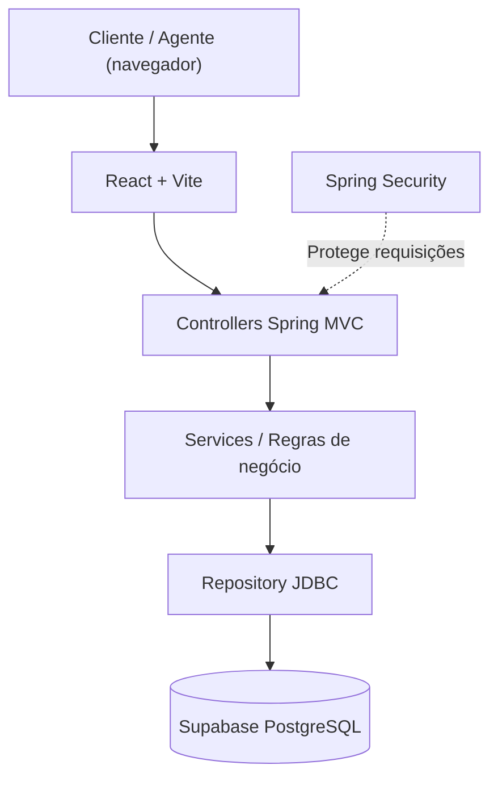
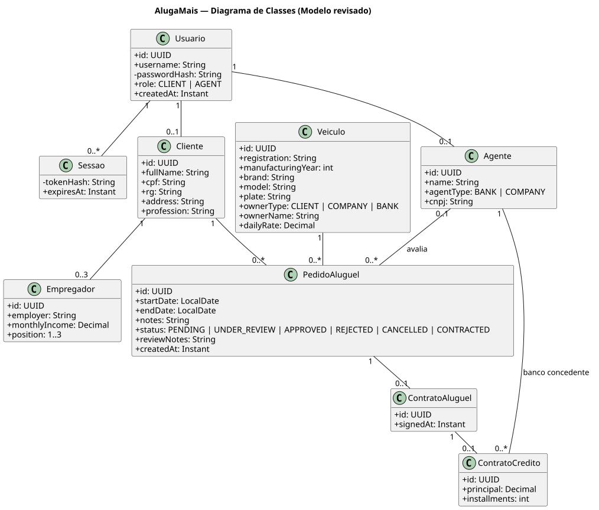
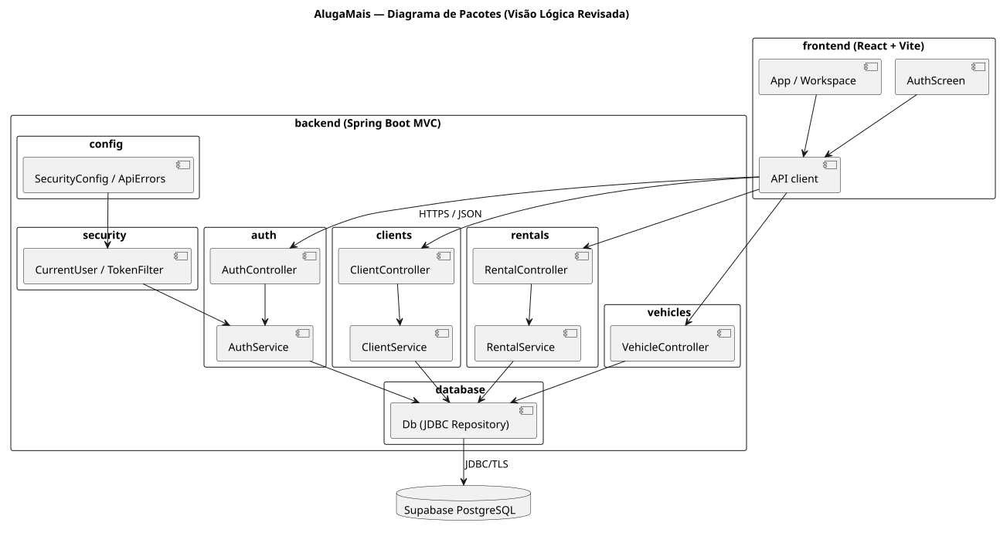

<p align="center"></p>

# AlugaMais — Sistema de Aluguel de Carros

**Laboratório 02 — Desenvolvimento e Integração de Aplicações Web (DIAW)**  
Engenharia de Software · PUC Minas · 2º período  
Aluno: **Luiz Gustavo Moura e Souza**  
Professor: **João Paulo Carneiro Aramuni**

## Sobre o projeto

O AlugaMais é um protótipo web para gestão de aluguéis de automóveis. Clientes cadastrados podem visualizar veículos, gerenciar seus dados, criar pedidos e acompanhar seus status. Agentes de empresas e bancos podem consultar solicitações, registrar parecer financeiro e formalizar contratos aprovados. Os dados são persistidos em PostgreSQL pelo Supabase.

O laboratório integra modelagem UML, autenticação, CRUD, arquitetura MVC e comunicação entre front-end e back-end.

## Status

**Protótipo acadêmico.** Inclui interface React, API Spring Boot, estrutura SQL, autenticação e documentação de modelagem. A execução completa exige configurar as credenciais de um projeto Supabase no ambiente local.

## Funcionalidades principais

| Cliente | Agente (empresa ou banco) |
| --- | --- |
| Cadastro e login com usuário/senha | Cadastro e login com perfil de agente |
| CRUD dos próprios dados | Consulta de clientes e pedidos |
| Até três empregadores e rendimentos | Análise financeira e parecer registrado |
| Consulta de veículos, propriedade e diárias | Aprovar, rejeitar ou manter em análise |
| Criar e modificar pedidos de aluguel | Modificar pedidos ainda abertos |
| Consultar o status e cancelar pedidos | Emitir contratos de pedidos aprovados |
| Consultar contratos próprios | Associar crédito concedido por banco agente |

**Regras importantes:** um veículo não pode receber pedidos ativos sobrepostos; cada pedido acompanha um status; contratos só são gerados após parecer positivo; o acesso é restrito a usuários autenticados e às permissões do perfil.

## Tecnologias utilizadas

| Camada | Tecnologia |
| --- | --- |
| Linguagem back-end | Java 25 |
| Framework web | Spring Boot 4.0.x (Spring MVC) |
| Arquitetura back-end | MVC com Controller, Service e Repository |
| Build Java | Apache Maven |
| Segurança | Spring Security, BCrypt e token temporário |
| Persistência | Spring JDBC, PostgreSQL (Supabase) |
| Front-end | React 19, TypeScript, Vite 7 |
| Estilos e ícones | CSS responsivo, Lucide React |
| Comunicação | API REST em JSON |

## Arquitetura



- **View:** interface responsiva em `frontend/src`.
- **Controller:** endpoints HTTP em `backend/.../auth`, `clients`, `rentals` e `vehicles`.
- **Model/Service:** dados e regras de cadastro, solicitações, análise e contratos.
- **Repository:** componente `Db` com consultas parametrizadas ao banco PostgreSQL.

Os dados ficam no Supabase. O navegador não acessa diretamente o banco nem recebe credenciais PostgreSQL. A API aplica as permissões de cliente e agente.

## Estrutura de diretórios

```text
.
├── backend/
│   ├── pom.xml
│   ├── .env.example
│   └── src/
│       ├── main/java/br/com/luizmoura/alugamais/
│       │   ├── auth/
│       │   ├── clients/
│       │   ├── config/
│       │   ├── database/
│       │   ├── rentals/
│       │   ├── security/
│       │   └── vehicles/
│       └── main/resources/
│           ├── application.properties
│           ├── schema.sql
│           └── data.sql
├── frontend/
│   ├── src/
│   │   ├── api.ts
│   │   ├── App.tsx
│   │   ├── AuthScreen.tsx
│   │   └── style.css
│   ├── package.json
│   └── vite.config.ts
└── docs/
    ├── historias-do-usuario.md
    ├── testes.md
    ├── arquitetura.md
    └── modelagem/
        ├── v1/
        └── v2/
```

## Como executar

### Pré-requisitos

- Java **JDK 25** instalado (`java -version`).
- Apache Maven 3.9 ou superior (`mvn -version`).
- Node.js 22 ou superior e npm.
- Projeto ativo no Supabase com conexão PostgreSQL.

### 1. Clonar o repositório

```bash
git clone https://github.com/LuizMoura06/Laboratorio-2-DIAW.git
cd Laboratorio-2-DIAW
```

### 2. Configurar banco de dados Supabase

No dashboard do Supabase, crie um projeto e acesse **Connect → Session Pooler** para obter host, usuário e senha da conexão PostgreSQL. Use a porta 5432 e conexão TLS, com `sslmode=require`.

No back-end, configure as variáveis de ambiente indicadas em `backend/.env.example`:

| Variável | Descrição |
| --- | --- |
| `SPRING_DATASOURCE_URL` | URL JDBC PostgreSQL do Supabase, incluindo `sslmode=require` |
| `SPRING_DATASOURCE_USERNAME` | Usuário da conexão do Supabase |
| `SPRING_DATASOURCE_PASSWORD` | Senha do banco PostgreSQL |
| `FRONTEND_ORIGIN` | Origem do navegador autorizada para CORS |

**Não suba arquivos `.env`, senhas ou chaves para o GitHub.** O arquivo `.gitignore` os exclui. As tabelas são criadas por `schema.sql` e a frota de seis carros é inserida por `data.sql` quando o Spring Boot inicia.

### 3. Iniciar a API Spring Boot

No terminal, exporte as variáveis de ambiente conforme o seu sistema operacional e execute:

```bash
cd backend
mvn spring-boot:run
```

API: `http://localhost:8080/api`  
Teste simples: `http://localhost:8080/api/health`

### 4. Iniciar o front-end

Em outro terminal:

```bash
cd frontend
npm ci
npm run dev
```

Acesse `http://localhost:5173`. O arquivo `frontend/.env.example` indica a variável opcional `VITE_API_URL` para substituir o endereço padrão da API.

### 5. Produção do front-end

```bash
cd frontend
npm run build
npm run preview
```

O build é gerado em `frontend/dist/`. Para disponibilizar o sistema na Internet, é necessário hospedar também a API Java e configurar sua conexão com o Supabase. Publicar somente os arquivos estáticos do React não disponibiliza as operações de cadastro ou aluguel.

## API REST

| Método | Endpoint | Permissão | Operação |
| --- | --- | --- | --- |
| POST | `/api/auth/register` | Público | Cadastro cliente ou agente |
| POST | `/api/auth/login` | Público | Login e token |
| GET | `/api/auth/me` | Autenticado | Sessão atual |
| POST | `/api/auth/logout` | Autenticado | Encerrar sessão |
| GET | `/api/vehicles` | Autenticado | Listar frota |
| GET | `/api/clients/me` | Cliente | Consultar cadastro |
| PUT | `/api/clients/me` | Cliente | Atualizar cadastro |
| DELETE | `/api/clients/me` | Cliente sem pedidos | Excluir cadastro |
| GET | `/api/clients` | Agente | Consultar clientes |
| POST/PUT/DELETE | `/api/clients/me/employments` | Cliente | Gerenciar empregadores (até 3) |
| GET | `/api/rentals` | Autenticado | Listar pedidos permitidos |
| POST | `/api/rentals` | Cliente | Criar pedido |
| PUT | `/api/rentals/{id}` | Cliente proprietário / agente | Modificar pedido aberto |
| PATCH | `/api/rentals/{id}/cancel` | Cliente proprietário | Cancelar pedido |
| PATCH | `/api/rentals/{id}/review` | Agente | Registrar parecer |
| POST | `/api/rentals/{id}/contract` | Agente | Formalizar contrato |
| GET | `/api/rentals/contracts` | Autenticado | Consultar contratos |
| GET | `/api/rentals/banks` | Autenticado | Bancos aptos ao crédito |

Todas as rotas protegidas recebem `Authorization: Bearer <token>` no cabeçalho. As senhas são armazenadas como hash BCrypt e os tokens de sessão são armazenados como hash SHA-256 com validade de 12 horas.

## Modelagem UML e histórias do usuário

Arquivos PlantUML da modelagem inicial e revisada:

| Artefato | Modelo inicial | Revisão conforme o código |
| --- | --- | --- |
| Casos de uso | [v1](docs/modelagem/v1/01-casos-de-uso.svg) · [fonte](docs/modelagem/v1/01-casos-de-uso.puml) | [v2](docs/modelagem/v2/01-casos-de-uso.svg) · [fonte](docs/modelagem/v2/01-casos-de-uso.puml) |
| Diagrama de classes | [v1](docs/modelagem/v1/02-classes.svg) · [fonte](docs/modelagem/v1/02-classes.puml) | [v2](docs/modelagem/v2/02-classes.svg) · [fonte](docs/modelagem/v2/02-classes.puml) |
| Diagrama de pacotes (visão lógica) | [v1](docs/modelagem/v1/03-pacotes.svg) · [fonte](docs/modelagem/v1/03-pacotes.puml) | [v2](docs/modelagem/v2/03-pacotes.svg) · [fonte](docs/modelagem/v2/03-pacotes.puml) |
| Histórias do usuário | — | [Histórias e critérios de aceitação](docs/historias-do-usuario.md) |

As versões iniciais mostram a estrutura planejada. Os diagramas revisados incorporam autenticação, empregadores, análise financeira, contratos, crédito e separação dos pacotes implementados. Veja [a evolução dos modelos](docs/arquitetura.md).

### Modelo de classes revisado



### Visão lógica revisada



## Testes

Para verificar o front-end:

```bash
cd frontend
npm run build
```

Para compilar e testar o back-end em ambiente com JDK 25 e Maven:

```bash
cd backend
mvn test
```

O projeto inclui 10 testes unitários de autenticação, validação, permissões, análise e contratos. A rotina de integração contínua em [`.github/workflows/ci.yml`](.github/workflows/ci.yml) executa a construção do React e os testes Java 25 a cada atualização do repositório.

Os cenários funcionais e o roteiro de apresentação estão em [docs/testes.md](docs/testes.md). O professor poderá usar contas criadas pela própria tela de cadastro; não existem senhas de demonstração expostas no repositório.

## Demonstração final

1. Acessar a tela de autenticação e criar um cliente.
2. Cadastrar até três empregadores e consultar veículos.
3. Criar pedido e mostrar o status pendente.
4. Entrar como agente de empresa e emitir parecer financeiro positivo.
5. Formalizar o contrato e mostrar a mudança de status.
6. Apresentar os diagramas v1 e v2 e explicar as modificações feitas no modelo.

## Decisões e limitações

- O sistema foi estruturado como protótipo acadêmico e não processa pagamentos reais nem consulta órgãos de crédito.
- A criação de agentes é aberta nesta versão para permitir demonstração de empresas e bancos. Em produção, a aprovação de agentes exigiria validação institucional.
- A identificação de proprietários de veículos utiliza tipo e nome do proprietário. A associação com contratos de crédito é feita por banco agente cadastrado.
- A interface usa armazenamento de sessão do navegador (`sessionStorage`), e a API valida o token em todas as chamadas protegidas.
- A estrutura SQL usa chaves e regras de integridade para preservar relações entre clientes, veículos, pedidos e contratos.

## Autor e referências

**Luiz Gustavo Moura e Souza** — Engenharia de Software, PUC Minas.  
[GitHub](https://github.com/LuizMoura06)

- [Spring Boot — documentação oficial](https://docs.spring.io/spring-boot/4.0/reference/)
- [React — documentação oficial](https://react.dev/)
- [Vite — documentação oficial](https://vite.dev/)
- [Supabase — conexão PostgreSQL](https://supabase.com/docs/guides/database/connecting-to-postgres)
- [Template de README da disciplina](https://github.com/joaopauloaramuni/desenvolvimento-e-integracao-de-aplicacoes-web/tree/main/TEMPLATES/template_README.md)

