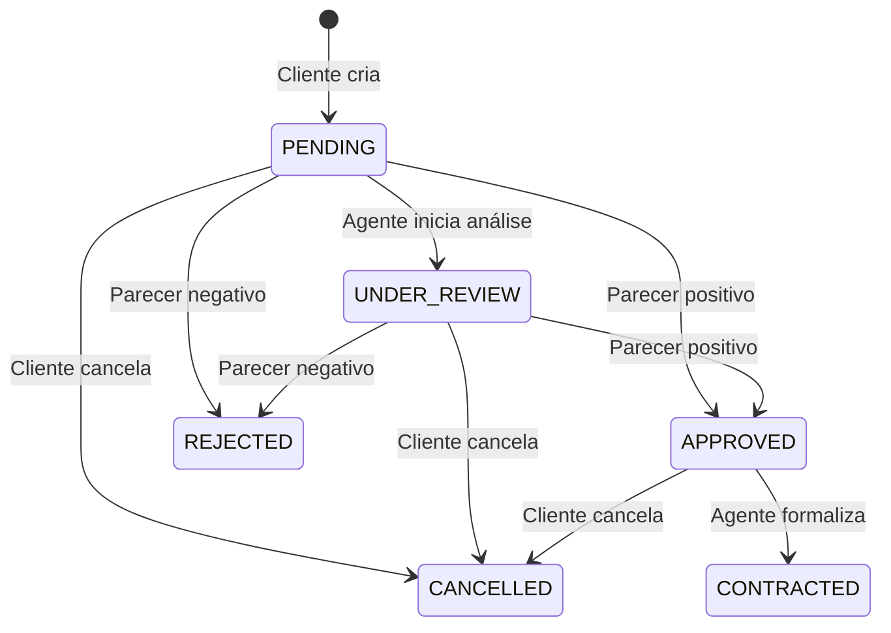

# Visão lógica e evolução da modelagem

## Versão inicial (v1)

A análise do enunciado começou pelos dois atores principais: cliente e agente. O primeiro modelo cobria cadastro, autenticação, pedidos e análise por agente. A arquitetura inicial tinha três camadas de back-end: Controller, Service e Repository.

## Versão revisada (v2)

Durante a definição das regras de negócio, foram adicionados os elementos necessários para atender à descrição completa: vínculos empregatícios (limite de três), propriedade do automóvel, contratos de aluguel, crédito concedido por banco e controle de sessões.

O diagrama de classes revisado representa as tabelas e os dados manipulados pelos serviços Java. Como foi adotado Spring JDBC, o modelo é materializado em `schema.sql` e acessado pelo repositório `Db`, com objetos de entrada tipados e objetos de saída em JSON. O projeto não utiliza ORM/JPA.

## Papéis dos pacotes

| Pacote | Responsabilidade |
| --- | --- |
| `auth` | Cadastro, login, emissão e encerramento de sessões |
| `security` | Identificação do usuário autenticado e proteção de rotas |
| `clients` | CRUD de cliente, empregadores e rendimentos |
| `vehicles` | Consulta ao catálogo e propriedades dos veículos |
| `rentals` | Solicitações, alterações, cancelamento, análise financeira e contratos |
| `database` | Persistência via JDBC e consultas SQL parametrizadas |
| `config` | Regras de segurança, CORS, respostas de erro e saúde da API |
| `frontend/src` | Telas, componentes, estado de interação e cliente REST |

## Fluxo de um pedido

## Alterações entre os modelos

1. Separação de `Usuario`, `Cliente` e `Agente`, com perfis e permissões distintos.
2. Inclusão de `Sessao` com token temporário, evitando acesso sem login.
3. Inclusão de `Empregador` com índice de 1 a 3 por cliente.
4. Inclusão de `ContratoAluguel` e `ContratoCredito` como entidades separadas.
5. Inclusão da associação entre pedido e agente responsável pelo parecer.
6. Separação dos pacotes reais do Spring MVC e do cliente React.

As versões anteriores foram preservadas em `docs/modelagem/v1`. Os arquivos atualizados estão em `docs/modelagem/v2`.

